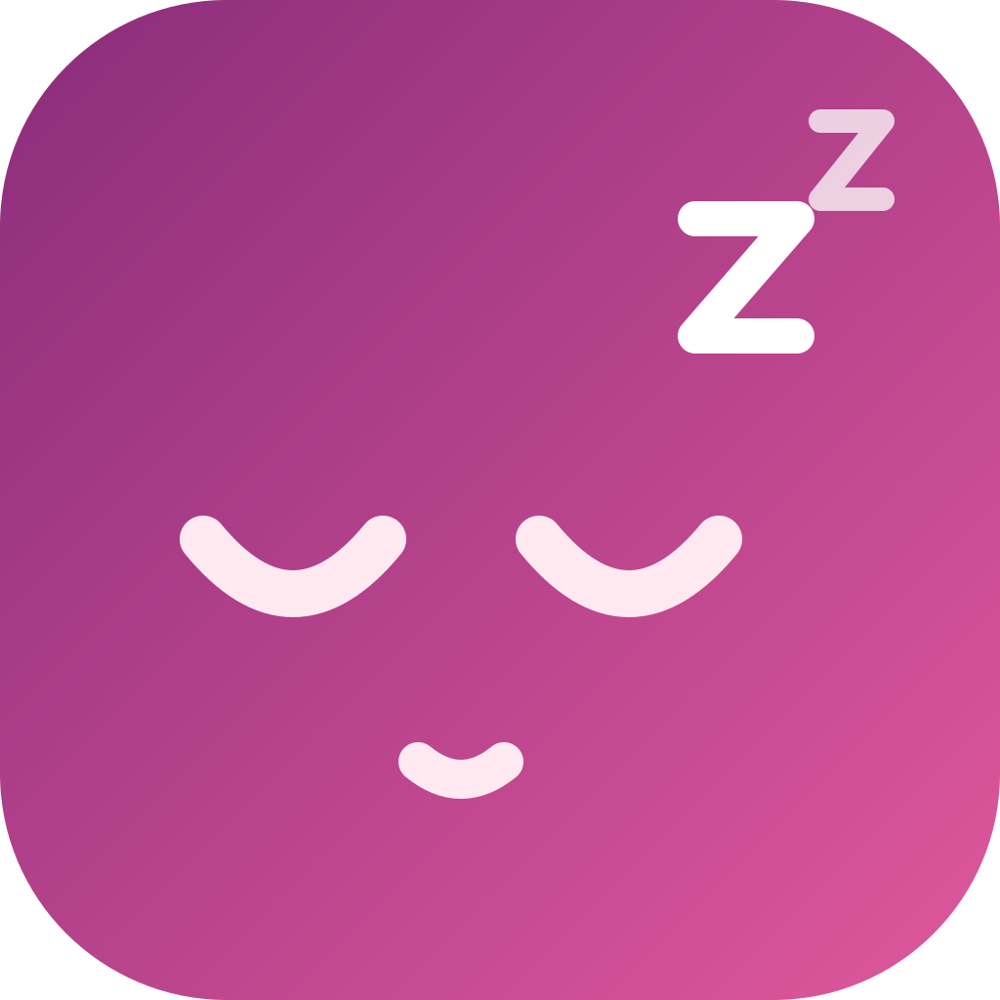

<p align="center">
  
</p>

# NightNight

<p align="center"><strong>NightNight is a rootless iOS jailbreak tweak that hibernates the device before the battery dies to save jailbroken state.</strong></p>

- Package: `com.burc334.nightnight`
- Version: `1.0.0`
- Tested: iOS 18.4.1
- Builds: rootless (`iphoneos-arm64`) and roothide (`iphoneos-arm64e`)
- License: MIT

## Compatibility

| Build | Architecture | Compatibility |
|---|---|---|
| roothide | `iphoneos-arm64e` | Tested on iOS 18.4.1 (Dopamine 3, roothide) |
| rootless | `iphoneos-arm64` | Expected to work on rootless jailbreaks |

Tested on iOS 18.4.1 (Dopamine 3, roothide). The package does not declare an iOS version restriction. It is built for jailbroken devices and is not an App Store app.

## Highlights

- Automatic hibernation at a configurable battery threshold.
- Manual **Hibernate Now** from Settings.
- Radio isolation while hibernating: Airplane Mode on, Wi-Fi and Bluetooth off. Calls and messages cannot arrive during hibernation.
- Notification banners, sounds, and vibration are silenced locally; notifications remain in Notification Center.
- Tap-to-wake and lift-to-wake are blocked during hibernation.
- Pressing the volume up button 3 times wakes the device.
- Optional wake on a new charger connection.
- Low Power Mode, media pause, screen lock, and backlight handling.
- Recovery snapshot restores radios, ringer, Low Power Mode, lock, and proximity state after a wake or restart.
- Settings apply immediately. Respring is not needed after changing them.

## Hibernation behavior

NightNight treats hibernation as a controlled sleep session, not a normal screen lock:

1. Airplane Mode is enabled.
2. Wi-Fi and Bluetooth are explicitly disabled.
3. The ringer is muted locally.
4. Low Power Mode is enabled if it was off.
5. Playing media is paused and left paused.
6. The screen is locked and the backlight is faded out.
7. A privileged helper requests system hibernation.
8. Tap, pencil, lift, and backlight wake events are blocked.

On wake, NightNight restores the previous Wi-Fi, Bluetooth, Airplane Mode, Low Power Mode, ringer volume, lock, and proximity state. It does not resume media that it paused.

Notification suppression is local to the device. NightNight does not use analytics or contact remote services.

## Wake and charging

- Pressing the volume up button 3 times always wakes NightNight.
- **Wake When Charger Connects** wakes the device on a new charger connection.
- If the charger is already connected when hibernation starts, NightNight waits for the next unplug/reconnect instead of waking immediately.
- While **Wake When Charger Connects** is on, the Wake Threshold is ignored and its slider is disabled.
- **Hibernate While Charging** controls whether automatic hibernation may start while the device is already connected. Manual hibernation is always available.

## Settings

| Setting | Default |
|---|---|
| Enable NightNight | On |
| Auto Hibernate | On |
| Sleep Threshold | 5% |
| Wake Threshold | 6% |
| Hibernate While Charging | Off |
| Wake When Charger Connects | Off |

The Sleep Threshold is used when Auto Hibernate is on. The Wake Threshold is used when Auto Hibernate is on and charger wake is off. The "Hibernate Now" button above still works when Auto Hibernate is off and the sliders are disabled.

## Install

### Sileo

Add `https://burc334.github.io/apt/` in Sileo, then install NightNight.

### Manual

1. Download the deb matching your jailbreak from the latest GitHub release:
   - roothide: `com.burc334.nightnight_1.0.0_iphoneos-arm64e.deb`
   - rootless: `com.burc334.nightnight_1.0.0_iphoneos-arm64.deb`
2. Install it with Sileo, Zebra, or Filza.
3. Respring after installation so SpringBoard loads the tweak and preference bundle.

After installation, open **Settings → NightNight** to configure the sleep and wake thresholds. Changes apply immediately.

## Build

Requirements: macOS, Xcode, Theos, ldid, and dpkg-deb.

```sh
export THEOS=$HOME/theos
make clean package FINALPACKAGE=1
./tools/make-roothide.sh
```

The rootless deb is written to `packages/`. The roothide script converts the latest rootless package to `iphoneos-arm64e`.

## Verification

SHA-256 checksums are published in `SHA256SUMS.txt` with the GitHub release.

## Support

Open an issue on the GitHub repository. Include your iOS version, jailbreak, device model, NightNight version, and the steps that led to the problem.

## License

MIT

AI-assisted development with DeepSeek-V4.1-Flash-1017.
